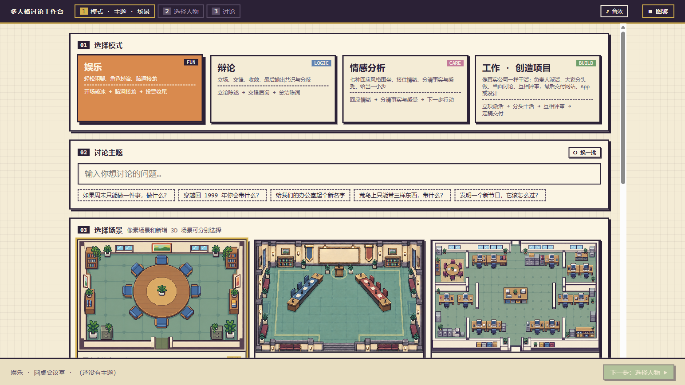
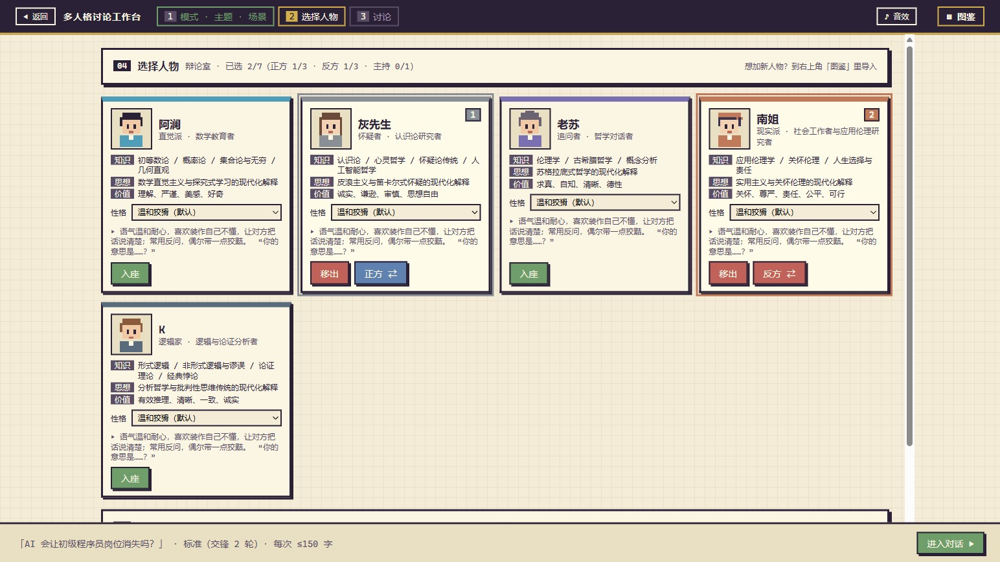
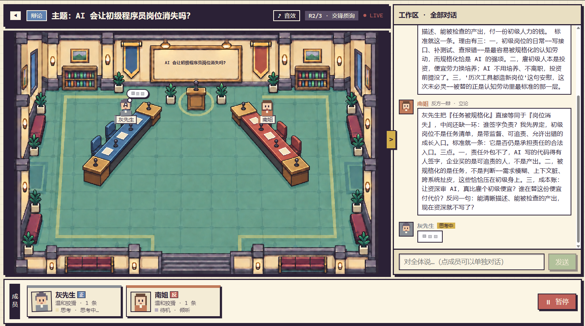
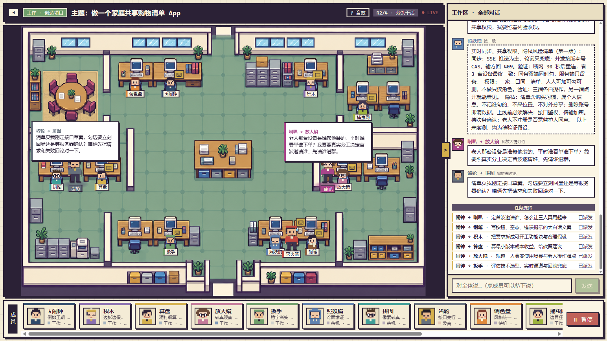

# muti-agent

**基于大语言模型的多智能体讨论工作台。**

muti-agent 将具有不同背景、性格和表达方式的 AI 角色组织到同一场讨论中。你可以选择主题、人物和场景，让角色围绕话题交流、辩论或分工协作，也可以随时加入对话。

项目提供四种讨论模式，以 2D 像素场景展示人物发言与互动，适合角色对话、观点梳理、情绪讨论和方案构思。

## 主要功能

### 四种讨论模式

| 模式 | 适用场景 | 讨论流程 | 内置人物 |
| --- | --- | --- | --- |
| 娱乐 | 轻松闲聊、角色扮演、创意接龙 | 开场互动、自由交流、总结收尾 | 8 人 |
| 辩论 | 比较不同立场、梳理论据与分歧 | 正反方立论、交锋质询、总结观点 | 5 人 |
| 情感分析 | 讨论个人感受与人际困扰 | 回应情绪、区分事实与感受、提出下一步行动 | 7 人 |
| 工作 | 拆解任务、协作构思、评审方案 | 负责人分配任务、成员并行产出、相互评审、汇总交付 | 13 人 |

辩论模式侧重呈现观点、共识与分歧，不进行评分或胜负判定。工作模式的交付内容是对话中的文本方案，目前不会实际创建网站、App 或项目文件。完整工作流程见[工作引擎说明](frontend/src/engines/product/README.md)。

### 人物与对话交互

- **人物选择与导入**：内置 33 位人物，支持查看人物图鉴、选择性格，以及导入自定义人物 JSON。
- **会话控制**：支持暂停、继续、向全体发言、与指定人物私聊，以及讨论结束后的追问；娱乐和情感分析还支持通过 `@名字` 点名。
- **协作过程展示**：工作模式在办公室场景中呈现工位走访、站会、会议与任务交付，便于理解成员之间的协作关系。

### 六个内置场景

提供圆桌会议室、辩论室、办公室、教室、草地野餐和播客访谈间。办公室设有 13 个工位，播客访谈间提供主持人与嘉宾的双人布局。也可以上传场景图片并设置座位，创建自定义场景。

## 快速开始

### 环境要求

- Node.js 20.19+（20.x）或 22.12 及以上版本，版本范围为 `^20.19.0 || >=22.12.0`。
- npm，以及用于获取仓库的 Git。
- 一个兼容 OpenAI Chat Completions 格式的模型服务，提供 API Key、接口地址和模型名称。

网页运行只需要 Node.js，无需启动 Python 服务。已有本地仓库时，可直接进入仓库根目录安装依赖；克隆完成后的命令均在仓库根目录执行。

### 1. 获取项目并安装依赖

```shell
git clone https://github.com/Maxworkinghard/muti-agent.git
cd muti-agent
npm run install:all
```

### 2. 配置模型服务

将 [frontend/.env.example](frontend/.env.example) 复制为 `frontend/.env`。已有配置时直接沿用，不要覆盖。PowerShell 下可以执行：

```powershell
if (-not (Test-Path frontend/.env)) {
    Copy-Item frontend/.env.example frontend/.env
}
```

打开 `frontend/.env`，根据所用模型服务填写以下变量：

| 变量 | 说明 |
| --- | --- |
| `LLM_API_KEY` | 模型服务提供的 API 密钥 |
| `LLM_BASE_URL` | API 基础地址；程序会自动追加 `/chat/completions`，此处不要重复填写该路径 |
| `LLM_MODEL` | 服务商支持的模型标识，需与接口要求一致 |

这些配置由服务端读取。请保留 `LLM_` 前缀，不要改成会暴露给浏览器的 `VITE_` 前缀；私人配置文件已被 Git 忽略。开发环境可通过 `frontend/.env.local` 覆盖基础配置，项目也兼容旧版 `ROUNDTABLE_*` 变量。

### 3. 启动开发服务

```shell
npm --prefix frontend run dev
```

在浏览器中打开终端显示的地址，默认是 `http://localhost:5173`；端口被占用时会自动顺延。该命令会同时启动页面、模型代理和 Node 会话服务。

### 4. 开始一场讨论

1. 选择讨论模式，输入主题或使用预设主题，再选择场景。
2. 选择参与人物和性格。辩论模式需要设置正反方；工作模式可以指定负责人。
3. 进入讨论室，发送背景说明、关心的问题，或一句“开始吧”，启动讨论。
4. 在讨论中向全体补充信息，或点击成员进行私聊。讨论正常结束后，还可以继续追问。

## 构建与部署

### 检查与构建

在仓库根目录执行：

```shell
npm test
npm run build
```

`npm test` 使用本地数据和模拟模型，检查讨论流程、人物与场景等功能，不调用真实模型服务。`npm run build` 执行前端类型检查，并生成两部分发布文件：

| 构建产物 | 用途 |
| --- | --- |
| `frontend/dist/` | 页面、脚本和静态资源 |
| `server-dist/api.mjs` | Node 模型代理与会话服务 |

部署时需要这两部分。单独运行 `npm --prefix frontend run build` 只更新前端页面。验证范围和方法见 [VERIFY.md](VERIFY.md)。

### 启动发布服务

完成构建和模型配置后，设置至少 16 个字符的访问密码并启动服务。以下密码为占位值，使用时请替换。

PowerShell：

```powershell
$env:APP_ACCESS_PASSWORD='replace-with-a-long-random-password'
$env:PORT='8080'
npm start
```

Bash：

```bash
APP_ACCESS_PASSWORD='replace-with-a-long-random-password' PORT=8080 npm start
```

使用上述端口时，可在本机打开 `http://localhost:8080`。浏览器会要求登录，用户名固定为 `roundtable`，密码为设置的 `APP_ACCESS_PASSWORD`。发布服务在同一端口提供页面和 API，两者均受访问密码保护；对外部署时应配置 HTTPS。

发布入口为 `serve.mjs`。模型与访问密码配置按 `frontend/.env`、`frontend/.env.production`、进程环境变量的顺序加载，后者覆盖前者。端口通过进程环境变量 `PORT` 设置，未设置时默认为 `5173`。

## 技术结构

前端使用 React、TypeScript 和 Vite。娱乐、辩论、情感分析的讨论流程在浏览器中调度，模型请求统一经过 Node 服务端代理；工作模式的流程在 Node 服务端执行，通过 SSE（服务器向浏览器持续推送事件）更新页面。

```text
frontend/src/          页面组件、讨论引擎、人物适配与 2D 场景
frontend/server/       模型代理、会话管理与工作模式流程
frontend/personas/     娱乐、情感分析和工作模式的人物资料
frontend/public/       场景图片、字体、音频等静态资源
frontend/docs/         前端文档与历史资料索引
backend/               辩论人物、性格资料及独立 Python 工具
persona-protocol/      人物数据格式、校验规则与示例
docs/                  人物指南、维护记录与界面截图
```

当前会话没有持久化数据库，刷新页面或重启服务后不会自动恢复讨论。导入的人物仅在当前页面会话中保留；自定义场景保存在当前浏览器的本地存储中，容量不足时仅本次打开有效。

正式工作台入口为 `/`。`/expression-demo.html` 提供静态 2D 表情样本，并随构建一同发布。更详细的模块关系见 [ARCHITECTURE.md](ARCHITECTURE.md)。

## 文档导航

| 阅读目的 | 文档 |
| --- | --- |
| 浏览项目文档 | [文档索引](docs/README.md) |
| 理解架构与运行方式 | [架构说明](ARCHITECTURE.md) |
| 创建、校验或导入人物 | [人物创建与上传指南](docs/人物角色创建与上传说明.md) |
| 维护前端和 Node 服务 | [前端维护说明](frontend/README.md)、[讨论引擎索引](frontend/src/engines/README.md) |
| 使用独立 Python 工具 | [Python 工具说明](backend/README.md) |
| 参与项目修改 | [协作入口](AGENTS.md)、[工程规范](STANDARDS.md)、[验证要求](VERIFY.md) |
| 查阅历史变更与恢复记录 | [维护审计](docs/MAINTENANCE_AUDIT.md)、[历史资料索引](frontend/docs/archive/README.md) |

## 界面预览

<details>
<summary>展开查看 2D 工作台截图</summary>

模式、主题与场景设置：



人物选择：



讨论与私聊：



工作模式办公室：



</details>
